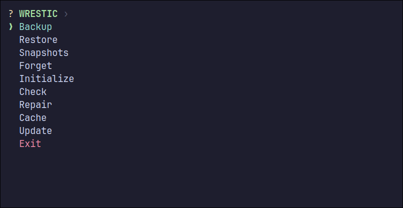
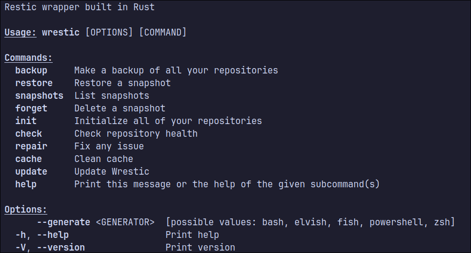

Para usar **Wrestic** solo tienes que ejecutar el siguiente comando:

```sh
sudo wrestic
```
Y se mostrará una pantalla como ésta:



Desde aquí puedes realizar varias acciones, pero es recomendable inicializar los repositorios primero.\
Puedes hacerlo en esta pantalla seleccionando `Initialize` o puedes ejecutar el commando directamente a través de la CLI:

```sh
sudo wrestic init
```
Este commando inicializará todos los repositorios que aún no hayan sido inicializados y se encuentren en tu archivo `wrestic.toml`.

## Comandos de Wrestic
Al ejecutar el commando:
```sh
sudo wrestic help
```
Se mostrará la siguiente pantalla:



## Autocompletado
Configurar el autocompletado para Wrestic es muy fácil.\
Lo único que tienes que saber es cuál es tu shell.\
Si no sabes cual es tu shell, puedes ejecutar:

```sh
echo $SHELL
```
Entonces... ¿Cómo puedo obtener autocompletado?\
Simplemente ejecuta:

```sh
sudo wrestic --generate  <NOMBRE DE TU SHELL>
```

Si tu shell es **bash** o **zsh** entonces **Wrestic** hará todo por ti,\
de modo que cuando reinicies tu shell tendrás autocompletados.

Si tu shell es diferente, entonces **Wrestic** generará todo lo que necesites para obtener autocompletados en tu shell.

***USUARIOS DE BASH, ATENCIÓN POR FAVOR:***\
Ten en cuenta que si tu shell es **BASH** necesitarás un paquete muy popular llamado:\
`bash-completion`