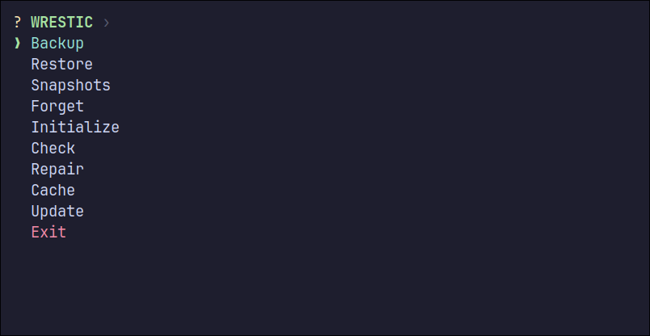
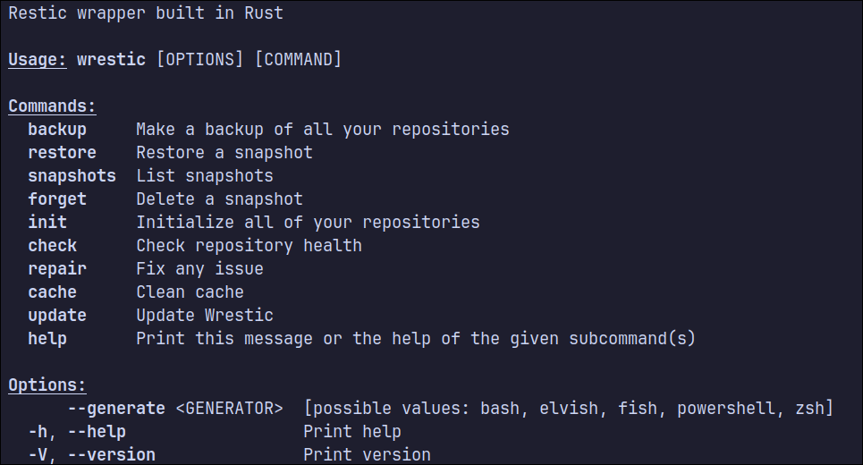

import { Card, CardGrid } from '@astrojs/starlight/components';

<CardGrid stagger>
	<Card title="Terminal User Interface (TUI)" icon="pencil">
		
	</Card>
	<Card title="CLI" icon="setting">
		
	</Card>
</CardGrid>
